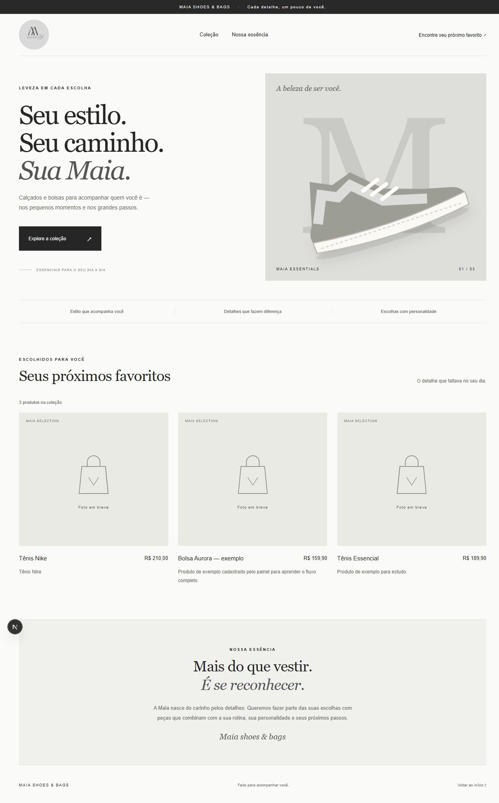
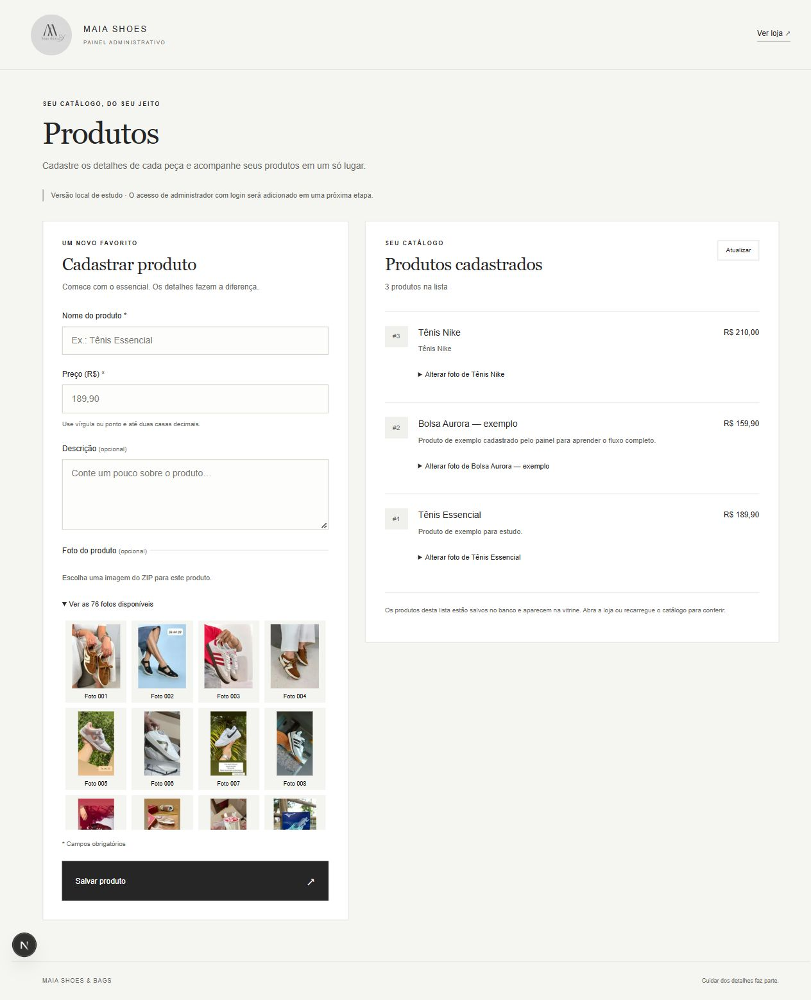

# MaiaShoes

Aplicação full stack de uma loja de calçados e bolsas, com vitrine e painel de produtos conectados ao PostgreSQL. Projeto pessoal em evolução, desenvolvido para aprender programação na prática e construir um portfólio com decisões técnicas documentadas.

## Funcionalidades

- Vitrine responsiva com nome, descrição, preço e foto principal dos produtos.
- Cadastro de produtos pelo painel administrativo.
- Galeria com 76 fotos fornecidas para o projeto.
- Seleção, troca e remoção da foto principal de produtos existentes.
- Categorias no cadastro, classificação de produtos existentes e filtros na vitrine.
- Login, cadastro de clientes, sessão com cookie HttpOnly e permissões de administrador na API.
- Validação de dados na API e preços armazenados como decimal.
- Persistência no PostgreSQL, com histórico de migrações.
- Tratamento de carregamento, coleção vazia e falhas na consulta.
- Testes automatizados e verificações no GitHub Actions.

**Em desenvolvimento:** esta versão foi preparada para uso local. Estoque, carrinho, pedidos, recuperação de senha e pagamentos fazem parte do planejamento. O catálogo é público; as operações de escrita exigem administrador autenticado.

## Tecnologias

| Camada | Ferramentas |
| --- | --- |
| Front-end | Next.js, React, TypeScript e CSS |
| Back-end | Node.js, NestJS e TypeScript |
| Banco | PostgreSQL e Prisma ORM |
| Testes | Vitest e Supertest |
| Versionamento | Git, GitHub e GitHub Actions |

```text
Navegador → Next.js → API NestJS → Prisma → PostgreSQL
```

O Next.js encaminha as chamadas `/api/products` para o NestJS na porta 3001. As credenciais do banco permanecem no back-end.

## Prévias

### Vitrine



### Painel de produtos e galeria



As capturas ilustram a interface durante o desenvolvimento. Os registros do banco local não são publicados neste repositório.

## Executar localmente

### Requisitos

- Node.js 24 e npm.
- PostgreSQL 18 em execução.
- Git.

Depois de clonar o repositório, abra o terminal na pasta do projeto.

### 1. Criar os bancos de desenvolvimento

No PostgreSQL, usando um administrador, execute separadamente e substitua a senha de exemplo:

```sql
CREATE ROLE maiashoes_app LOGIN PASSWORD 'SUBSTITUA_POR_UMA_SENHA_LOCAL';
CREATE DATABASE maiashoes OWNER maiashoes_app;
CREATE DATABASE maiashoes_shadow OWNER maiashoes_app;
```

O banco `maiashoes_shadow` é auxiliar para as migrações locais e deve ser diferente do banco da aplicação. O usuário do projeto não precisa ser administrador do PostgreSQL.

### 2. Preparar e iniciar o back-end

```powershell
cd backend
npm ci
Copy-Item .env.example .env
```

Edite `backend/.env` com sua senha local e os endereços dos bancos. Depois:

```powershell
npm run db:migrate
npm run db:generate
npm run start:dev
```

API: [http://127.0.0.1:3001/api/health](http://127.0.0.1:3001/api/health).

### Criar o primeiro administrador

Em outro terminal de `backend/`, depois de configurar o banco:

```powershell
npm run build
Copy-Item .env.admin.example .env.admin.local
```

Edite `.env.admin.local` com nome, usuário e uma senha local. Esse arquivo é ignorado pelo Git. Depois execute `npm run admin:create`. O comando cria apenas a primeira conta: não altera senhas nem promove clientes já existentes. Não há usuário ou senha padrão no repositório.

### 3. Iniciar o front-end

Em outro terminal, a partir da raiz:

```powershell
cd frontend
npm ci
npm run dev
```

- Loja: [http://localhost:3000](http://localhost:3000).
- Painel: [http://localhost:3000/admin](http://localhost:3000/admin).
- Login: [http://localhost:3000/login](http://localhost:3000/login).
- Cadastro de cliente: [http://localhost:3000/cadastro](http://localhost:3000/cadastro).
- Conta: [http://localhost:3000/conta](http://localhost:3000/conta).

Cadastre um produto pelo painel, selecione uma foto e atualize a loja. Cada cadastro cria um registro novo. Para ver dados, a API e o PostgreSQL precisam estar em execução.

O painel exige login de administrador. O cadastro público cria somente clientes. A documentação de [login e permissões](docs/AUTENTICACAO.md) explica sessões, proteção das rotas e exercícios para verificar os dois perfis.

O script `backend/scripts/setup-local-db.mjs` é uma conveniência específica do ambiente original. A instalação a partir de um clone segue os passos acima e não exige as credenciais administrativas do autor.

## Estrutura

```text
frontend/
  src/app/                 # Vitrine, componentes e painel
  src/lib/                 # Tipos e comunicação com a API
  src/data/                # Manifesto das fotos importadas
  public/products/         # Imagens dos produtos
backend/
  src/products/            # Rotas, validação e regras de produtos
  src/database/            # Integração com o PostgreSQL
  prisma/                  # Modelo e migrações
  test/                    # Testes HTTP
scripts/                   # Importação local das fotos
.github/                   # CI e modelo de pull request
docs/                      # Prévias e registro de aprendizado
```

## Rotas da API

| Método | Caminho | Função |
| --- | --- | --- |
| GET | `/api/health` | Verificar o servidor |
| GET | `/api/health/database` | Verificar a conexão e a tabela de produtos |
| GET | `/api/products` | Listar os produtos |
| POST | `/api/products` | Cadastrar um produto |
| PATCH | `/api/products/:id/image` | Alterar ou remover a foto principal |
| PATCH | `/api/products/:id/category` | Alterar a categoria de um produto existente |
| POST | `/api/auth/register` | Criar conta de cliente e iniciar sessão |
| POST | `/api/auth/login` | Entrar com e-mail ou usuário e senha |
| GET | `/api/auth/google/status` | Consultar disponibilidade do login Google |
| GET | `/api/auth/google/start` | Iniciar login Google configurado |
| GET | `/api/auth/google/callback` | Receber retorno do Google |
| GET | `/api/auth/me` | Consultar a própria sessão |
| POST | `/api/auth/logout` | Revogar a sessão e limpar o cookie |

Exemplo de cadastro:

```json
{
  "name": "Tênis de exemplo",
  "description": "Descrição do produto.",
  "price": "189.90",
  "category": "TENIS",
  "imageUrl": "/products/foto-001.jpeg"
}
```

O preço é enviado como texto decimal para preservar os centavos. A API aceita somente caminhos das fotos importadas. O campo de imagem é opcional; `null` remove a associação na rota de atualização.

POST e PATCH de produtos exigem sessão de administrador. As chamadas de escrita também exigem `X-MaiaShoes-Request: 1`; o front-end envia esse cabeçalho automaticamente como proteção contra solicitações de outros sites.

## Verificações

Dentro de `backend/`, com `.env` configurado:

```powershell
npm run build
npm test
npm run test:e2e
```

Dentro de `frontend/`:

```powershell
npm run build
```

Os testes HTTP usam um substituto do banco para verificar os contratos e as validações. O CI também cria um PostgreSQL temporário, aplica as migrações e confere a conexão real pela API. As credenciais do CI são descartáveis e não correspondem às do ambiente local.

## Próximas etapas

- [x] Categorias no cadastro e filtros na vitrine.
- [x] Autenticação e autorização de administrador.
- [ ] Recuperação de senha e verificação de contato.
- [ ] Estoque por tamanho e cor.
- [ ] Edição completa de produtos.
- [ ] Carrinho e pedidos.
- [ ] Integração de pagamento.
- [ ] Publicação da aplicação em um ambiente adequado.

## Aprendizado e desenvolvimento

O [registro de aprendizado](docs/APRENDIZADO.md) reúne a evolução por etapas. O [guia de contribuição](CONTRIBUTING.md) descreve o fluxo de branches, commits e pull requests para as próximas atualizações.

A [etapa de categorias](docs/CATEGORIAS.md) acompanha o campo desde a migração até os filtros da vitrine e inclui um exercício para praticar.

Arquivos `.env`, credenciais, dependências e builds são excluídos do Git. O repositório contém somente `.env.example`, com valores de exemplo.

## Código e material visual

O repositório é público para apresentação do projeto. Não foi concedida uma licença geral de reutilização. Fotos, marcas e identidade visual mantêm os direitos de seus respectivos titulares.
